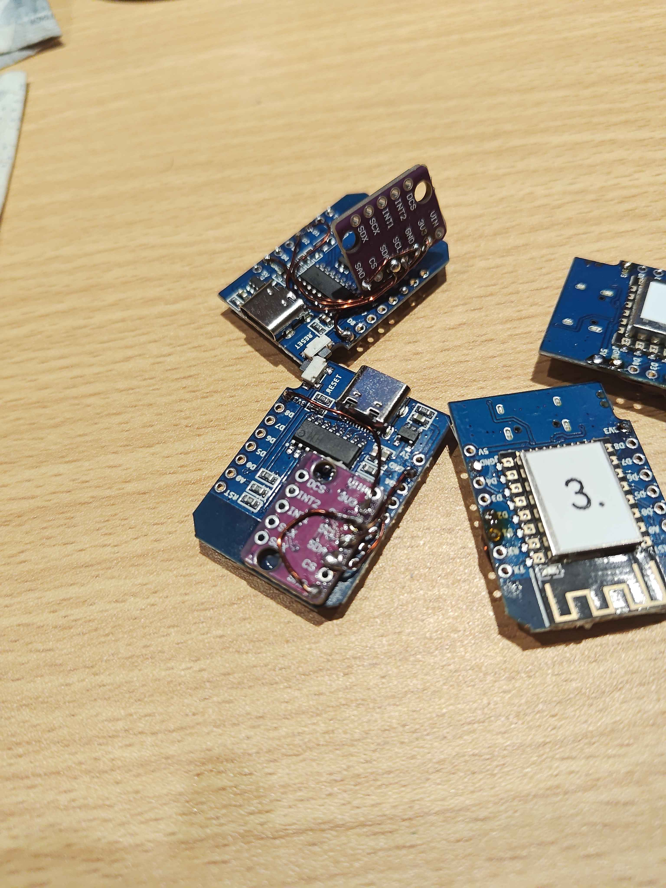

# yolk-slimevr

DIY SlimeVR full-body tracking (FBT) build using **GY-LSM6DS3** IMUs, **Wemos D1 Mini** (ESP8266) microcontrollers, and **built-in small LiPo** batteries (2000 mAh, D1 Mini size) in **3D-printed** cases.

This repo documents the complete plan, parts list (with purchase links), wiring, firmware, calibration, and case design for a SlimeVR tracker setup.

> **Working on a tracker? Start with [FLASH_AND_USE.md](FLASH_AND_USE.md)** — the end-to-end agent guide: flashing firmware (incl. the `IMU_AUTO` gotcha), diagnosing the failure modes found in the first build, and using the tracker after flashing.

## Contents

| Document | What it covers |
|---|---|
| [docs/01-overview.md](docs/01-overview.md) | What SlimeVR is, tracker count, architecture |
| [docs/02-parts-list.md](docs/02-parts-list.md) | Full BOM with Tokopedia product links |
| [docs/03-wiring.md](docs/03-wiring.md) | Pinout, wiring diagram, power chain |
| [docs/04-firmware.md](docs/04-firmware.md) | Flashing SlimeVR firmware, `defines.h` config |
| [docs/05-calibration.md](docs/05-calibration.md) | 6-side calibration (LSM6DS3/SoftFusion) + temperature calibration |
| [docs/06-case-design.md](docs/06-case-design.md) | 3D case design, dimensions, hot-swap battery |
| [docs/07-assembly.md](docs/07-assembly.md) | Step-by-step build guide |
| [docs/08-server-setup.md](docs/08-server-setup.md) | SlimeVR server + SteamVR OpenVR driver |
| [docs/09-troubleshooting.md](docs/09-troubleshooting.md) | Common failures and fixes |
| [docs/10-battery-module.md](docs/10-battery-module.md) | Strap-held battery module for tool-free cell swaps |

## Quick parts summary

| Part | Pick |
|---|---|
| MCU | **Wemos D1 Mini** (ESP8266, micro USB) |
| IMU | **GY-LSM6DS3** (LSM6DS3TR-C 6DoF + e-compass, I²C) — soldered on the backside |
| Battery | **Built-in small LiPo** (2000 mAh, ~34×25×5 mm, D1 Mini size) — wires soldered directly to the shield |
| Battery shield | **Wemos D1 Mini battery shield** — soldered directly onto the D1 Mini |
| Charger | **TP4056** (on the shield) — micro USB, accessible from outside the case |
| Power switch | **Toggle switch** — between the shield GND and D1 GND, accessible from outside |
| Case | 3D-printed (designed around the parts) |

> The **Wemos D1 Mini battery shield** is soldered directly onto the D1 Mini. The **TP4056 charger** is on the shield. The **battery** is a small built-in LiPo (2000 mAh, D1 Mini size) with wires soldered directly to the shield — not hot-swappable. A **toggle switch** between the shield GND and D1 GND turns the device on/off, accessible from outside the case. Both the **charging USB port** and the **D1 Mini USB port** are accessible from outside. See [docs/02-parts-list.md](docs/02-parts-list.md).

## Media

### CAD renders

| Top linework | Isometric (above) |
|---|---|
|  |  |

| Bottom isometric | Bottom interior |
|---|---|
|  |  |

### 3D print results

| Top isometric | Charging LED visible |
|---|---|
|  |  |

| PCB half-assembled | PCB hanging off (corner) |
|---|---|
|  |  |

### Build

| IMU soldered (backside) | Final product (3D printed case, assembled) |
|---|---|
|  |  |

- **Build demo (video):** [`media/build-demo.mp4`](media/build-demo.mp4) — full soldered unit (no case) demonstrated with SlimeVR running on the PC.

## Status

Build in progress. See [docs/02-parts-list.md](docs/02-parts-list.md) for purchase links and [docs/07-assembly.md](docs/07-assembly.md) for the assembly guide.
